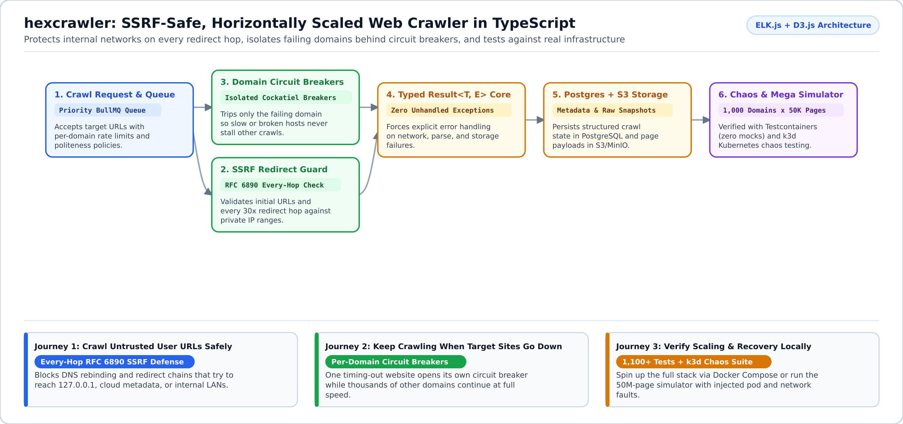

# hexcrawler

**Crawl thousands of domains safely without SSRF vulnerabilities, cascading timeouts, or unhandled worker crashes.**

`hexcrawler` is a horizontally scalable TypeScript web crawler built with BullMQ, PostgreSQL, S3/MinIO, and Kubernetes. It is designed for teams that need to fetch user-submitted or third-party URLs in production without exposing internal infrastructure or letting one broken website stall the entire queue.



---

## Why Use `hexcrawler`? (What Problem Does It Solve?)

Most simple web crawlers work fine on 10 friendly test pages and fail in production for three reasons:

1. **Redirects can trick your server into attacking your own private network (*SSRF*[^ssrf])**: A public URL can redirect (`301`/`302`) to `http://127.0.0.1`, an internal database, or a cloud metadata IP (`169.254.169.254`). `hexcrawler` validates the initial URL **and every single redirect hop** against RFC 6890 private address ranges before connecting.
2. **One slow or dead website blocks everyone else**: Without isolation, a single hanging domain ties up all your worker threads. `hexcrawler` wraps every domain in its own *circuit breaker*[^circuit-breaker] and rate limiter so failing sites are paused automatically while healthy domains continue at full speed.
3. **Network and database blips crash workers**: Instead of throwing uncaught exceptions, every layer uses typed `Result<T, E>` return values so every error is handled explicitly and tested against real Redis, PostgreSQL, and MinIO containers (zero mocks).

---

## Start in 2 Minutes

### 1. Build & Run the 1,100+ Test Suite (No External Infra Needed)

```bash
pnpm install && pnpm build
pnpm test              # Runs 1,100+ unit & domain tests
pnpm verify:guards     # Full typecheck + lint + architecture guard chain
```

### 2. Launch the Full Stack Locally

```bash
# Option A: Docker Compose (API + Workers + Redis + Postgres + MinIO in one command)
docker compose -f infra/docker/docker-compose.dev.yml --profile demo up

# Option B: Local Kubernetes (k3d) with autoscaling + 50M-page simulator + chaos testing
scripts/setup-local.sh
scripts/run-k8s-e2e-test.sh
scripts/teardown-local.sh
```

---

## Adapt to Your Use Case (Customer Journeys)

<details open>
<summary><b>1. Security-Conscious SaaS Teams -- Fetching Untrusted User URLs Safely</b></summary>

- **Who this is for**: SaaS products, AI knowledge-base ingestion pipelines, and link previewers that fetch URLs supplied by end users.
- **Problem solved**: Enforces RFC 6890 SSRF blocking on every redirect hop, caps response payload sizes, and isolates untrusted fetches from your internal network.
</details>

<details>
<summary><b>2. High-Volume Data & Search Pipelines -- Scaling Across 1,000+ Domains</b></summary>

- **Who this is for**: Data engineering teams crawling thousands of heterogeneous websites with different rate limits and uptime reliability.
- **Problem solved**: Per-domain politeness delays and Cockatiel circuit breakers ensure one overloaded host never starves the rest of your crawl fleet. Workers scale horizontally via Kubernetes HPA.
</details>

<details>
<summary><b>3. Platform & SRE Engineers -- Chaos Testing & Observability</b></summary>

- **Who this is for**: Infrastructure engineers validating distributed system resilience under real network, pod, and database failures.
- **How to use it**: Run `scripts/run-chaos-test.sh` and `scripts/run-autoscale-test.sh` against the built-in mega simulator (1,000 domains x 50,000 pages) with Prometheus alert verification (`pnpm test:alerts`) and Grafana dashboards.
</details>

---

## Documentation & Deep Dives

| Guide | What You Will Find Inside |
| :--- | :--- |
| [**Getting Started (`docs/GETTING-STARTED.md`)**](docs/GETTING-STARTED.md) | Step-by-step Docker Compose, k3d Kubernetes setup, port forwards, and live dashboards. |
| [**Architecture (`docs/ARCHITECTURE.md`)**](docs/ARCHITECTURE.md) | Hexagonal ports-and-adapters design, OpenAPI/TypeSpec contracts, and storage layout. |
| [**Load & Chaos Testing (`docs/LOAD-TESTING.md`)**](docs/LOAD-TESTING.md) | k6 load profiles, Chaos Mesh fault injection, and Horizontal Pod Autoscaler benchmarks. |
| [**ADRs (`docs/adr/`)**](docs/adr/) & [**Feature Specs (`docs/specs/`)**](docs/specs/) | 22 Architecture Decision Records and 22 formal EARS feature specifications. |

[^ssrf]: **SSRF (Server-Side Request Forgery)**: A security vulnerability where an attacker tricks a server into making HTTP requests to internal-only addresses (such as `localhost` or cloud credentials endpoints).
[^circuit-breaker]: **Circuit Breaker**: An automatic safety switch that temporarily stops sending requests to a failing domain so your workers do not waste time waiting on timeouts.
